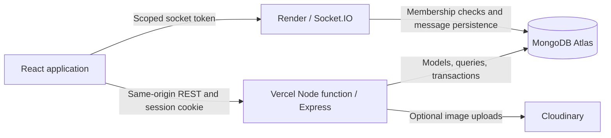

# CollabHub

**Find your people. Build something great.**

A MERN collaboration platform where students, developers, designers, and makers find projects, recruit teammates, and build together in private workspaces.

[](https://github.com/KoushikNandugade/collab-hub/actions/workflows/ci.yml)
[](LICENSE)

[Open CollabHub](https://collab-hub-phi.vercel.app) · [Setup and deployment](docs/deployment.md) · [Architecture and API](docs/architecture.md) · [Demo checklist](docs/demo.md)

## Problem statement

Students and independent makers often have project ideas but struggle to find collaborators with the right skills, interests, and availability. Recruitment happens in disconnected chats, while applications, team capacity, tasks, resources, and discussions become difficult to track.

## Target users

CollabHub is built for students, developers, designers, and makers who want to join a project or recruit a small team for a side project, hackathon, or open-source idea.

## Solution

CollabHub brings discovery, recruitment, and delivery into one application. Owners publish projects with specific openings; collaborators apply or receive invitations. Acceptance updates team membership and available capacity in a transaction, then grants access to a private workspace with tasks, resources, and persisted conversations.

## Core workflows

| Workflow                            | User outcome                                                                                       |
| ----------------------------------- | -------------------------------------------------------------------------------------------------- |
| Register and complete onboarding    | Establish an account, skills, interests, and collaboration preferences                             |
| Discover a project and apply        | Search suitable projects, inspect openings, save an idea, and submit an application                |
| Review an application or invitation | Admit a collaborator without exceeding role or team capacity                                       |
| Collaborate in a private workspace  | Assign tasks, update Kanban status, share resources, and retain progress across sessions           |
| Communicate and return              | Exchange direct/project messages, receive notifications, and recover access after signing in again |

## Features

- **Profiles and onboarding:** skills, interests, experience, availability, goals, and portfolio links.
- **Project discovery:** search, filters, sorting, pagination, saved projects, and explained recommendations.
- **Team recruitment:** multiple roles, applications, invitations, and transaction-protected team capacity.
- **Private workspaces:** four-stage Kanban tasks, assignments, resources, discussions, and activity history.
- **Messaging:** persisted direct and project conversations, unread counts, live delivery, and typing indicators through Socket.IO; five-second refresh when sockets are unavailable.
- **Notifications:** application decisions, invitations, task assignments, messages, and project updates.
- **Authentication and access control:** bcrypt passwords, JWT sessions in HTTP-only cookies, session revocation, and owner/member permissions.
- **Optional image uploads:** Cloudinary integration; image URLs work without Cloudinary credentials.

Pages read real database records. Sample community content is available through a separate seed command. Recommendations use a deterministic weighted formula, described in the [architecture guide](docs/architecture.md#explainable-matching).

## Technology

| Layer                  | Technologies                                                                   |
| ---------------------- | ------------------------------------------------------------------------------ |
| Frontend               | React 19, Vite 7, Tailwind CSS 4, React Router, TanStack Query, Motion, Lucide |
| Forms                  | React Hook Form, Zod                                                           |
| Backend                | Node.js 22+, Express 5, Mongoose, MongoDB                                      |
| Sessions and messaging | JWT, bcrypt, HTTP-only cookies, Socket.IO                                      |
| Testing                | Node.js test runner, Playwright, GitHub Actions                                |
| Hosting                | Vercel frontend/API, Render Web Service for persistent sockets, MongoDB Atlas  |

## Architecture



Vercel serves the built React application and the shared Express API. MongoDB stores accounts, projects, recruitment state, tasks, conversations, and notifications. Render maintains socket connections for live messaging; the browser falls back to periodic message refresh when sockets are unavailable. Sessions use HTTP-only cookies; cross-host socket access uses short-lived, audience-restricted tokens. The same API can also run as a standalone Express service.

See [architecture and API reference](docs/architecture.md) for data models and routes, and [engineering decisions](docs/engineering-decisions.md) for the reasoning and tradeoffs.

## Run locally

Install Node.js 22 or newer, npm, and Docker with Compose. MongoDB must support transactions: use the included local replica set or MongoDB Atlas.

```bash
git clone https://github.com/KoushikNandugade/collab-hub.git
cd collab-hub
npm ci
cp .env.example .env
```

Generate a signing secret, then paste the generated value into `JWT_SECRET` in your private `.env`:

```bash
node -e "console.log(require('node:crypto').randomBytes(48).toString('hex'))"
```

Start the local database, wait for its primary to become ready, then start the application:

```bash
docker compose up -d mongo mongo-init
npm run dev
```

Open **http://localhost:5173**. The API runs on **http://localhost:3001**, and Vite proxies `/api` and `/socket.io` to it. To use Atlas instead, skip the Docker command and replace `MONGODB_URI` in `.env` with your private Atlas connection string.

### Environment variables

| Variable                                                               | Purpose                                                                        |
| ---------------------------------------------------------------------- | ------------------------------------------------------------------------------ |
| `MONGODB_URI`                                                          | MongoDB replica-set connection string; required by the API                     |
| `JWT_SECRET`                                                           | Random signing secret of at least 32 characters; required by the API           |
| `CLIENT_ORIGIN`                                                        | Browser origin; `http://localhost:5173` for development                        |
| `PORT`                                                                 | Local API port; defaults to `3001`; Render supplies its own port               |
| `NODE_ENV`                                                             | `development` locally, `production` when hosted                                |
| `REALTIME_URL`                                                         | Optional override; the production function defaults to the existing Render URL |
| `CLOUDINARY_CLOUD_NAME`, `CLOUDINARY_API_KEY`, `CLOUDINARY_API_SECRET` | Optional image-upload configuration                                            |

Keep secret values in `.env` or hosting settings. Never commit them or prefix them with `VITE_`. See [.env.example](.env.example) for non-secret local examples.

### Optional sample data

```bash
npm run seed
```

The seed inserts six fictional profiles and six projects, preserving existing records. Sample accounts use reserved `demo.invalid` emails and random, undisclosed passwords. An optional private `SEED_PASSWORD` can enable demonstration logins before the first seed; do not publish a shared password. Re-running the seed does not reset accounts.

## Commands

| Command              | Purpose                                                            |
| -------------------- | ------------------------------------------------------------------ |
| `npm run dev`        | Start the frontend and API                                         |
| `npm run build`      | Build frontend assets into `client/dist`                           |
| `npm start`          | Serve the built frontend, API, and sockets through Express         |
| `npm test`           | Run API, Socket.IO, and serverless integration checks              |
| `npm run test:e2e`   | Run browser tests against a running local app                      |
| `npm run dev:vercel` | Run the Vercel function harness on port `3004`                     |
| `npm run verify`     | Run API tests, build, and browser tests; a running app is required |
| `npm run seed`       | Insert optional sample community records                           |
| `npm run format`     | Format source and documentation                                    |

## Repository structure

```text
.github/              CI workflow, issue forms, and pull request template
api/index.js          Vercel entry point for the shared Express API
client/src/
  components/         Shared controls, navigation, and layouts
  lib/                API client and authentication context
  pages/              Landing, onboarding, discovery, dashboard, workspaces, chat
  main.jsx            Application routes and providers
  styles.css          Design system and responsive styles
server/src/
  controllers/        Authentication and profile handlers
  middleware/         Session authentication and authorization
  models/             Ten indexed Mongoose models
  routes/             Project, workspace, community, and messaging routes
  services/           Database, membership transactions, matching, and messaging
  sockets/            Authenticated Socket.IO handlers
  utils/              Shared helpers and safe startup diagnostics
  validators/         Request validation schemas
  app.js              Express application factory
  index.js            HTTP, database, and socket startup
  seed.js             Optional sample data
server/test/          API and Socket.IO integration tests
e2e/                  Desktop and mobile Playwright workflows
scripts/              Local Vercel function harness
docs/                 Architecture, deployment, demo, and verification guides
compose.yaml          Local MongoDB replica set and optional app container
Dockerfile            Multi-stage image with non-root production runtime
vercel.json           Frontend build, API rewrites, and SPA routing
.env.example          Non-secret environment configuration template
```

## Testing

Start the local MongoDB replica set before `npm test`. Integration tests use and drop only the isolated local databases `collabhub_test_phase1`, `collabhub_test_workflows`, and `collabhub_test_vercel`. Never run test workflows against production.

For browser tests, start `npm run dev` in another terminal, then:

```bash
npm run seed
npx playwright install chromium
npm run test:e2e
```

Browser tests create disposable users and exercise onboarding, projects, persistent tasks, resources, messages, recruitment, session recovery, and mobile discovery. They mutate the target database; use a local development environment. GitHub Actions runs the suite against both Vite/Express and the Vercel function harness. See the [verification record](docs/verification.md) for completed checks and their limits. The [submission checklist](docs/submission-readiness.md) maps this evidence to the end-term guidelines.

## Deployment

- **Public application:** https://collab-hub-phi.vercel.app
- **Persistent socket service:** https://collab-hub-d51v.onrender.com
- **Frontend build output:** `client/dist`, with the Vercel Root Directory at the repository root.

Both hosts need their own **identical** `MONGODB_URI` and `JWT_SECRET` values. Set `CLIENT_ORIGIN=https://collab-hub-phi.vercel.app` on Render and `REALTIME_URL=https://collab-hub-d51v.onrender.com` on Vercel. Redeploy after changing variables. Render uses a normal Node Web Service; no Blueprint or account API key is needed for dashboard setup.

The separate **Verify public deployment** workflow checks the published page, API/database readiness, signed-out authorization, and Render transport/CORS without creating application records. It can be run from GitHub Actions; it also runs when its checker or workflow changes. The [public deployment check](https://github.com/KoushikNandugade/collab-hub/actions/runs/40600436400) passed all six endpoint checks, including both database health endpoints, project discovery, signed-out protection, and Render transport/CORS. The separate **Verify live workflows** check uses labeled test accounts with random, undisclosed passwords to exercise recruitment, tasks, and cross-host messaging, and archives its test project. See [verification evidence](docs/verification.md) and [submission readiness](docs/submission-readiness.md) for the current result and account-level security items.

## Scope

This version does not include password reset, email verification, OAuth, moderation tools, end-to-end message encryption, or file attachments. Cloudinary uploads require separate account configuration and live verification.

Contributions are welcome; see [CONTRIBUTING.md](CONTRIBUTING.md). Report vulnerabilities using [SECURITY.md](SECURITY.md). Licensed under the [MIT License](LICENSE).
